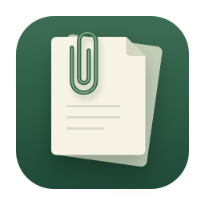
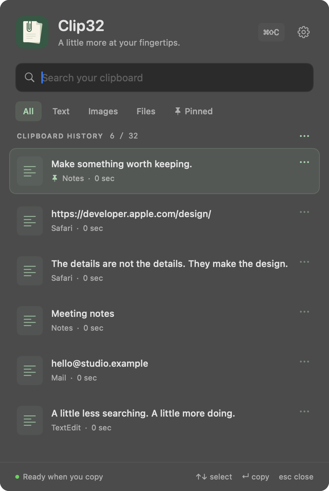

# Clip32

A native macOS menu bar clipboard app with a paper-inspired icon and calm green accents. Copy normally with **⌘C**, then press **⌘⇧C** to find something you copied earlier. Clip32 stays in the background and can open automatically when you log in.

It starts with **32 entries**. Choose any history size from **1 to 256** in Settings, pin the things you reuse, and keep text, images, and copied file references on your Mac.



## Install the Mac app

Download **`Clip32-1.1.0-universal.dmg`** from the [v1.1.0 release](https://github.com/Paradox560/clip32/releases/tag/v1.1.0). The universal app supports **Apple silicon and Intel Macs running macOS 13 or later**. You do not need Xcode, Swift, an account, or any developer tools to use the packaged app.

**Preview signing status:** this release is ad-hoc signed and has **not been notarized by Apple**. Gatekeeper may block a downloaded copy. A Developer ID-signed, notarized release is required for normal downloaded-app approval; the project includes that release workflow, but this preview does not claim that approval.

1. Open the DMG and drag **Clip32.app** to the **Applications** folder beside it.
2. Eject the disk image and open Clip32 from Applications.
3. Follow the three-step setup: learn the clipboard workflow, choose startup and paste preferences, then start using Clip32.

For direct paste, enable Clip32 in **System Settings → Privacy & Security → Accessibility** when the setup guide asks. Until access is enabled, selecting an entry copies it and you can press **⌘V** yourself. Clipboard capture and the shortcut work without Accessibility or Input Monitoring permission.

Launch at login is enabled on first launch. If macOS requires approval, allow Clip32 under **System Settings → General → Login Items**. You can change startup and paste preferences later in Settings. Clip32 lives in your menu bar and does not occupy a Dock slot.

To update, quit Clip32 from its menu bar before replacing the app in Applications. Your history and preferences are retained. A changed ad-hoc signature may require you to remove and re-add Clip32 in Accessibility settings.

## Use your clipboard

- Copy text, images, or files with **⌘C**. Copy commands from app menus also work.
- Press **⌘⇧C**, search or filter the history, and choose an entry to return it to your previous app.
- Pin frequently used entries. Pins count toward your chosen history limit and survive clearing recent history.
- Copying identical content moves the existing entry to the front. When history is full, the oldest unpinned entry makes room for new content.
- Pause capture, remove individual entries, or clear recent history from the history panel. Settings also offers a separate action to delete everything, including pins.
- Change the open-history shortcut to **⌃⌥C** or **⌘⌥C** in Settings if **⌘⇧C** conflicts with another app.

| Shortcut inside history | Action |
| --- | --- |
| ↑ / ↓ | Select an entry |
| Return | Paste the selected entry, or copy it if direct paste is unavailable |
| ⌘1–⌘9 | Choose one of the first nine visible entries |
| ⌘P | Pin or unpin the selected entry |
| ⌘⌫ | Delete the selected entry |
| ⌘F | Focus search |
| ⌘, | Open Settings |
| Esc | Close history and return to the previous app |

## History size and storage limits

Set **History limit** in Settings and click **Apply**. The default is 32; the supported range is **1–256 items**. Reducing the limit asks for confirmation when it will remove entries, then trims the oldest unpinned entries. A limit below your number of pinned entries is rejected. If every slot is pinned, unpin or delete an item before new copies can be saved.

History also has a **512 MiB total payload limit** and a **16 MiB limit per entry**, including all saved representations. Large images can therefore reach the storage limit before the chosen item count. The oldest unpinned entries are removed as needed to stay within the total budget; if pinned content prevents a new item from fitting, it is skipped with a message. Unsupported clipboard formats and entries over 16 MiB are also skipped.

File entries retain **references to their original locations**, not copies of the file contents. Moved or deleted files cannot be restored from Clip32. Rich text and supported image representations are preserved. Capture starts with new copies after Clip32 opens, and saved history survives app and computer restarts.

## Privacy

Clip32 does not upload clipboard contents or sync them to the cloud. History is stored locally in `~/Library/Application Support/Clip32`. Its directory uses owner-only `0700` permissions and its history file uses `0600`; the stored history is **not encrypted**.

Common password-manager confidential, concealed, and transient clipboard markers are excluded. Sensitive content copied by an app that does not supply those markers can still be recorded. Pause capture before copying something you do not want saved, or delete it from history afterward.

Accessibility access is used only to send the paste command to your previous app. No Accessibility or Input Monitoring permission is required to collect clipboard changes or register the history shortcut.

## Build from source

Development requires macOS and Xcode or a compatible Swift 5.9-or-newer toolchain. The project uses Swift Package Manager, AppKit, SwiftUI, and system frameworks, with no downloaded package dependencies.

```sh
git clone https://github.com/Paradox560/clip32.git
cd clip32
swift test --scratch-path .build
./Scripts/build.sh
```

The build script creates **`dist/Clip32.app`**, with both `arm64` and `x86_64` executables by default. For a faster build for your development machine, specify one architecture:

```sh
CLIP32_ARCHS=arm64 ./Scripts/build.sh
# Or: CLIP32_ARCHS=x86_64 ./Scripts/build.sh
```

Install a local build in `~/Applications` with `./Scripts/install.sh`. The installer checks the bundle identifier and asks you to quit an existing Clip32 process before replacement. Open the bundled app for login-item registration; running the bare Swift executable is insufficient.

## Package a release

Build and package a universal disk image:

```sh
./Scripts/package-dmg.sh
```

To package an app you have already built:

```sh
./Scripts/package-dmg.sh --skip-build
```

The script creates a versioned DMG and a SHA-256 checksum in `dist/`. It includes the app, an Applications shortcut, and an installation guide. The actual mounted image is checked for bundle identity, code-signature validity, and matching executable contents before delivery.

Builds are **ad-hoc signed by default**. For a distribution release, configure an installed Developer ID Application identity and an existing `notarytool` keychain profile, then run:

```sh
SIGNING_IDENTITY='Developer ID Application: Your Name (TEAMID)' \
NOTARY_KEYCHAIN_PROFILE='your-saved-notary-profile' \
./Scripts/package-dmg.sh
```

This signs with the hardened runtime, submits the app and DMG for notarization, checks for acceptance, and staples the resulting tickets. Signing credentials are supplied through your local keychain and environment, not committed to this repository.

## Project layout

- `Sources/ClipCore`: clipboard capture, history limits, pinning, and persistent storage.
- `Sources/Clip32`: menu bar app, native views, setup guide, hotkey, login, and paste integration.
- `Tests/ClipCoreTests`: behavior tests using temporary files and synthetic named pasteboards, without reading your real clipboard history.
- `Scripts`: app and icon generation, local installation, and DMG packaging.

The app name remains **Clip32**. Its paperclip logo contains no text or capacity number.
